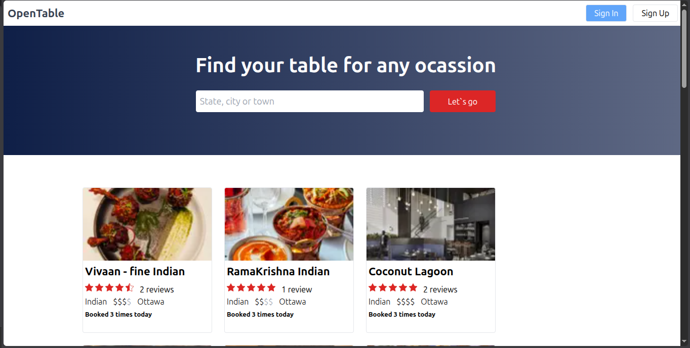

# OpenTable

A modern restaurant booking and discovery application built with Next.js 13, TypeScript, Supabase, and Material UI.



## Features

- Secure authentication with bcrypt, jose, and jsonwebtoken
- Schema validation for reliable request and data handling
- Responsive UI with Material UI
- PostgreSQL database powered by Supabase
- Cookie-based session storage using cookies-next
- API context setup for clean app-wide state access
- HTTP requests with axios

## Tech Stack

- Next.js 13
- TypeScript
- Supabase DB (PostgreSQL)
- Material UI
- bcrypt
- jose
- jsonwebtoken
- axios
- schema validation
- cookies-next

## Getting Started

### Prerequisites

- Node.js 18+
- npm or yarn
- A Supabase project and environment variables

### Install dependencies

```bash
npm install
# or
yarn install
```

### Run the development server

```bash
npm run dev
# or
yarn dev
```

Open http://localhost:3000 to view the app in your browser.

### Environment variables

Create a `.env.local` file and add your Supabase and auth configuration values as needed for your project.

## Project Structure

- `app/` — main application pages and layout
- `components/` — reusable UI components
- `lib/` — utilities and configuration
- `pages/api/` — API routes
- `public/` — static assets including images

## Notes

This project was bootstrapped with Next.js and includes the default app structure generated by `create-next-app`.

## Learn More

- [Next.js Documentation](https://nextjs.org/docs)
- [Learn Next.js](https://nextjs.org/learn)
- [Next.js GitHub Repository](https://github.com/vercel/next.js)

## Deployment

You can deploy this project to Vercel with the standard Next.js deployment flow.

- [Vercel Platform](https://vercel.com/new?utm_medium=default-template&filter=next.js&utm_source=create-next-app&utm_campaign=create-next-app-readme)
- [Next.js Deployment Documentation](https://nextjs.org/docs/deployment)
